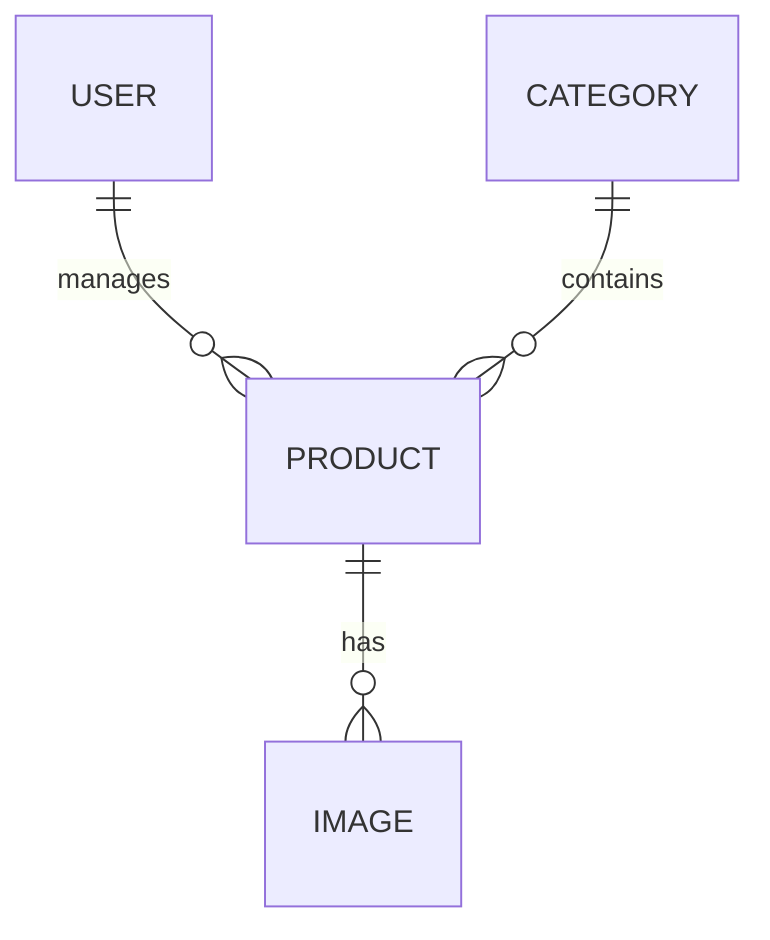
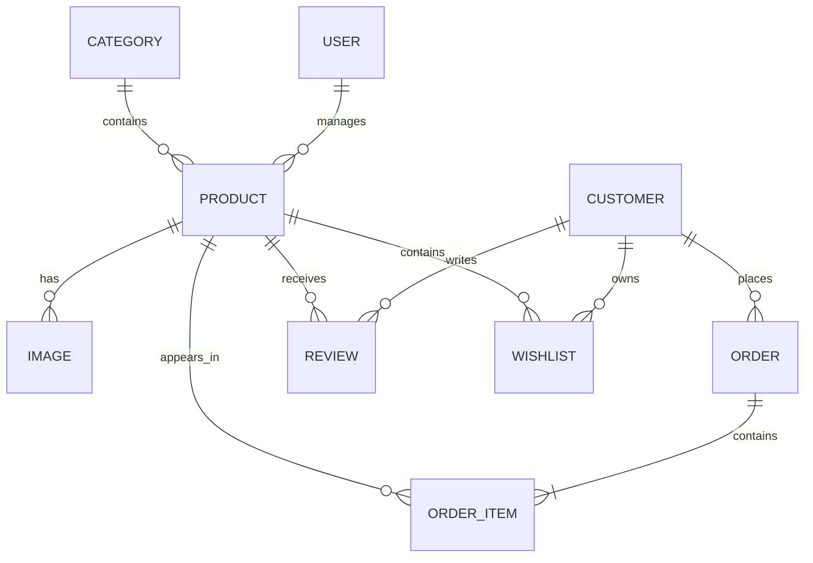

# Database Design

## Purpose

This document describes the database design of the Puhen Svqt application.

It defines the database technology, entity relationships, design principles, naming conventions, and future expansion strategy.

The database is designed to support the current product catalog while providing a scalable foundation for future e-commerce functionality.

---

# Database Technology

Version 2 uses:

- PostgreSQL
- Prisma ORM

PostgreSQL provides a reliable relational database capable of handling complex relationships and future business growth.

Prisma serves as the application's Object-Relational Mapper (ORM), providing type-safe database access and schema management.

---

# Design Principles

The database follows these principles:

- Normalize data where appropriate.
- Preserve referential integrity.
- Avoid duplicated data.
- Model real business relationships.
- Keep entities focused on a single responsibility.
- Design for future expansion.

---

# Entity Relationship Diagram



---

# Current Database Relationships

| Parent Entity | Child Entity | Relationship |
|---------------|--------------|--------------|
| User | Product | One-to-Many |
| Category | Product | One-to-Many |
| Product | Image | One-to-Many |

---

# Entity Overview

## User

Represents an authenticated administrator responsible for managing the application.

### Relationships

- Manages multiple Products.

---

## Category

Represents a logical grouping of products.

### Relationships

- Contains multiple Products.

---

## Product

Represents a handcrafted item available through the Puhen Svqt catalog.

### Relationships

- Belongs to one Category.
- Managed by one User.
- Contains one or more Images.

---

## Image

Represents a product image.

### Relationships

- Belongs to one Product.

---

# Naming Conventions

## Prisma Models

Prisma models use singular names.

Example:

```prisma
model Product
model Category
model Image
model User
```

---

## Database Tables

Database tables use plural names through Prisma's mapping feature.

Example:

```prisma
model Product {

    @@map("products")
}
```

---

## Primary Keys

Every entity uses a globally unique identifier.

```prisma
id String @id @default(cuid())
```

---

## Foreign Keys

Foreign keys follow the convention:

```text
userId

categoryId

productId
```

---

## Timestamps

Entities should contain:

```text
createdAt

updatedAt
```

where applicable.

---

# Database Constraints

## User

- Email addresses must be unique.

---

## Category

- Category names must be unique.

---

## Product

- Every product belongs to one Category.
- Every product is managed by one User.

---

## Image

- Every image belongs to one Product.
- Every product should contain at least one image.
- One image may be designated as the primary product image.

---

# Future Expansion

The current schema intentionally supports future e-commerce features without requiring structural redesign.

Planned entities include:

- Customer
- Order
- OrderItem
- Wishlist
- Review
- Shopping Cart
- Inventory
- Discount
- Coupon

Future relationships may be represented as:



These entities are documented to ensure that current architectural decisions remain compatible with future application growth.

---

# Design Decisions

## PostgreSQL

A relational database was selected because the application contains strongly related business entities that require referential integrity and efficient querying.

---

## Prisma ORM

Prisma provides:

- Type-safe queries.
- Simple schema management.
- Excellent developer experience.
- Strong PostgreSQL integration.

---

## Separate Image Entity

Images are modeled as a separate entity instead of storing a single image URL inside the Product model.

Benefits include:

- Multiple product images.
- Product galleries.
- Primary image selection.
- Easier migration to cloud storage.

---

## Separate Category Entity

Categories are represented as their own entity rather than an enumeration.

This allows administrators to:

- Create categories.
- Edit categories.
- Delete categories.
- Expand the catalog without modifying application code.

---

## Future-Proof Design

The schema is designed to evolve incrementally.

Future modules should extend the existing database rather than replace or redesign it.