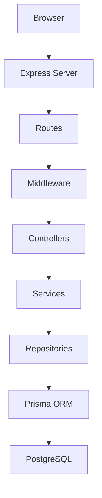
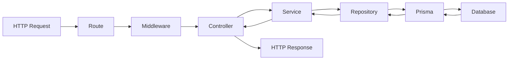
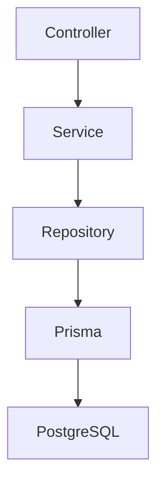
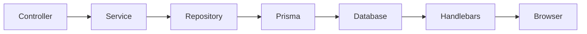

# Application Architecture

## Purpose

This document describes the internal architecture of the Puhen Svqt application.

It defines the architectural style, application layers, responsibilities, request lifecycle, and design principles used throughout the project.

The primary goal is to create a modular, maintainable, and scalable application that can evolve into a complete e-commerce platform.

---

# Architectural Style

Puhen Svqt follows a layered MVC (Model-View-Controller) architecture.

Each layer has a single responsibility and communicates only with the layer directly below it.

This separation allows the application to remain maintainable, testable, and easy to extend.

---

# High-Level Architecture

---

# Request Lifecycle

Every request follows the same processing pipeline.

---

# Application Layers

## Browser

The browser represents the client application.

Responsibilities:

- Display rendered HTML.
- Execute client-side JavaScript.
- Submit forms.
- Send HTTP requests.

The browser never communicates directly with the database.

---

## Express Server

Express is the application's entry point.

Responsibilities:

- Initialize the application.
- Configure middleware.
- Register routes.
- Handle incoming HTTP requests.
- Configure the template engine.
- Handle global errors.

---

## Routes

Routes define the application's public interface.

Responsibilities:

- Match URLs.
- Match HTTP methods.
- Apply middleware.
- Delegate requests to controllers.

Routes should never contain business logic.

---

## Middleware

Middleware executes before controllers.

Responsibilities:

- Authentication
- Authorization
- Cookie parsing
- Validation
- Logging
- Static file serving

Middleware should remain reusable and independent of business logic.

---

## Controllers

Controllers coordinate communication between the client and the application's business layer.

Responsibilities:

- Receive requests.
- Extract request data.
- Call services.
- Render views.
- Return JSON responses.
- Redirect users.

Controllers should remain thin.

They should not contain business logic or database queries.

---

## Services

Services contain the application's business logic.

Responsibilities:

- Execute business rules.
- Coordinate operations.
- Validate business constraints.
- Communicate with repositories.
- Prepare data for presentation.

Services should remain independent of HTTP-specific functionality.

---

## Repositories

Repositories provide the application's data access layer.

Responsibilities:

- Execute database queries.
- Retrieve entities.
- Persist entities.
- Hide Prisma implementation details.

Repositories should never contain business logic.

---

## Prisma ORM

Prisma acts as the bridge between the application and PostgreSQL.

Responsibilities:

- Execute CRUD operations.
- Generate SQL.
- Manage entity relationships.
- Map database records to JavaScript objects.

---

## PostgreSQL

PostgreSQL stores all persistent application data.

Responsibilities:

- Persist data.
- Enforce relationships.
- Maintain referential integrity.
- Execute SQL queries.

---

# Dependency Direction

Application dependencies always flow downward.

Lower layers never depend on higher layers.

For example:

- Services do not know about Express.
- Repositories do not know about Controllers.
- Prisma does not know about business logic.

---

# Rendering Strategy

Version 2 primarily uses Server-Side Rendering (SSR).

Controllers render Handlebars templates that generate HTML on the server.

---

# REST API

Although Version 2 uses Server-Side Rendering, the backend is designed to expose REST endpoints.

Example:

GET /api/products

GET /api/categories

GET /api/products/:id

These endpoints return JSON and allow future frontend applications to reuse the same business logic.

---

# Design Principles

The application follows the following software engineering principles.

## Separation of Concerns

Each layer has one responsibility.

---

## Single Responsibility Principle

Every module should perform one task only.

---

## Modularity

Features are organized into independent modules.

---

## Reusability

Business logic should be reusable by both Handlebars and future React applications.

---

## Scalability

New features should be added without redesigning existing modules.

---

## Maintainability

The architecture should remain understandable as the project grows.

---

# Future Evolution

The architecture is designed to support future modules such as:

- Customer Accounts
- Shopping Cart
- Orders
- Payments
- Reviews
- Wishlist
- Inventory
- Notifications

These modules should integrate into the existing architecture while preserving the existing layer responsibilities.

---

# Architectural Goals

The architecture aims to:

- Separate presentation from business logic.
- Isolate database access behind repositories.
- Reduce coupling between modules.
- Increase maintainability.
- Simplify testing.
- Support future React integration.
- Support long-term project evolution.