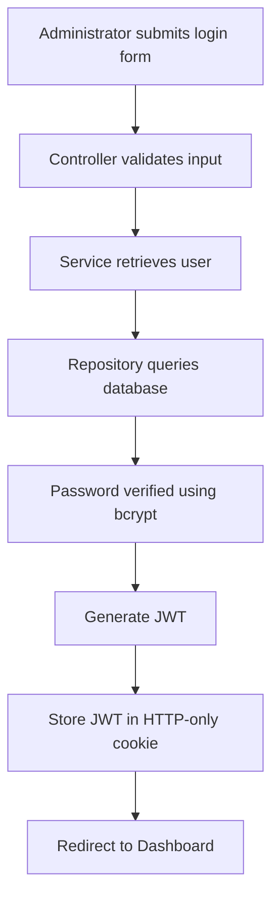
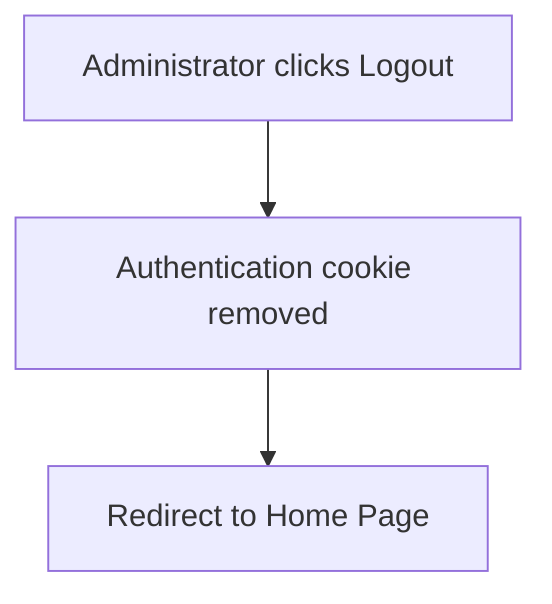

# Authentication

## Purpose

This document describes the authentication and authorization mechanisms used by the Puhen Svqt application.

Authentication verifies the identity of a user, while authorization determines which actions that user is permitted to perform.

Version 2 supports authentication for administrators only. Future versions will extend the same authentication system to customer accounts.

---

# Authentication vs Authorization

Authentication answers:

> **Who is the user?**

Authorization answers:

> **What is the user allowed to do?**

Authentication and authorization are independent concerns and are handled separately throughout the application.

---

# Authentication Technology

Version 2 uses:

- JSON Web Tokens (JWT)
- HTTP-only Cookies
- bcrypt
- Express Middleware

Passwords are securely hashed using bcrypt before being stored in the database.

Authentication state is maintained using JWTs stored inside HTTP-only cookies.

---

# Administrator Provisioning

Administrator accounts are **not publicly registered**.

Instead, administrator accounts are created during application setup.

Typical setup process:

```text
Clone Repository

↓

Install Dependencies

↓

Run Database Migrations

↓

Run Database Seed

↓

Administrator Account Created

↓

Administrator Logs In
```

Future versions may allow existing administrators to create additional administrator accounts through a protected administration interface.

---

# Login Flow



---

# Logout Flow



---

# JWT Payload

The JWT stores only the minimum information required for authentication.

Example payload:

```json
{
    "id": "user-id",
    "email": "admin@puhensvqt.com"
}
```

Passwords and other sensitive information are never stored inside the token.

---

# Cookie Configuration

The JWT is stored inside an HTTP-only cookie.

Example:

```javascript
res.cookie("auth", token, {
    httpOnly: true
});
```

In production, additional options such as `secure` and `sameSite` should also be enabled.

---

# Authentication Middleware

Every incoming request passes through the authentication middleware.

Responsibilities:

- Read the authentication cookie.
- Verify the JWT signature.
- Decode the token.
- Attach the authenticated user to the request.
- Make the user available to views.
- Remove invalid authentication cookies.

If no token exists, the request continues as a guest.

If the token is invalid, the cookie is removed and the user is redirected to the login page.

---

# Authorization Middleware

Authorization controls access to protected resources.

Version 2 provides two middleware functions.

## isAuthenticated

Allows access only to authenticated users.

Examples:

- Product Management
- Category Management
- Image Management
- Administration Panel

---

## isGuest

Allows access only to guests.

Used for:

- Login

Authenticated users attempting to access guest-only pages are redirected to the application's home page.

---

# Protected Routes

Examples of protected routes include:

```
GET /admin

GET /products/create

POST /products/create

GET /products/:id/edit

POST /products/:id/edit

GET /products/:id/delete

POST /products/:id/delete
```

Guests attempting to access protected routes are redirected to the login page.

---

# Password Security

Passwords are never stored in plain text.

Authentication process:

1. Password submitted.
2. Password compared using bcrypt.
3. Stored hash verified.
4. Authentication granted if valid.

Only password hashes are stored inside the database.

---

# Session Management

Puhen Svqt uses stateless authentication.

The server does not store sessions.

Instead:

```text
Browser

↓

HTTP-only Cookie

↓

JWT

↓

Authentication Middleware
```

Each request independently verifies the authentication token before processing.

---

# Security Considerations

The authentication system follows several security practices:

- Passwords are hashed using bcrypt.
- JWT payload contains minimal information.
- Authentication tokens are stored inside HTTP-only cookies.
- Invalid authentication cookies are removed automatically.
- Protected routes require authentication.
- User input is validated before authentication.

Future improvements may include:

- Secure Cookies
- SameSite Cookies
- Refresh Tokens
- Password Reset
- Two-Factor Authentication (2FA)

---

# Future Customer Authentication

Future versions will introduce customer accounts.

The authentication architecture will remain unchanged.

Only the available user roles will expand.

```text
Guest
│
├── Browse Products
├── Login
└── Register

↓

Customer

↓

Shopping Cart

Orders

Wishlist

Reviews
```

Administrators will continue to be provisioned internally rather than through public registration.

---

# Design Decisions

## JWT Authentication

JWT provides stateless authentication without requiring server-side session storage.

---

## HTTP-only Cookies

Authentication tokens are stored inside HTTP-only cookies to reduce the risk of token theft through client-side JavaScript.

---

## Middleware-Based Authentication

Authentication is centralized within middleware.

Controllers, services, and repositories remain independent of authentication logic.

---

## Manual Administrator Provisioning

Administrator accounts are intentionally created during system setup rather than through public registration.

This approach:

- Improves security.
- Matches real-world e-commerce platforms.
- Prevents unauthorized administrator creation.
- Simplifies Version 2 authentication.

Customer self-registration will be introduced in a future version without changing the existing authentication architecture.